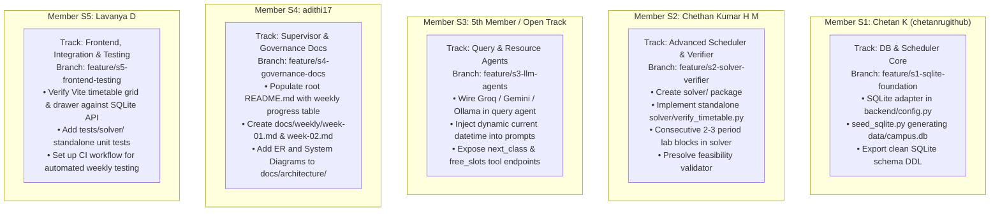

# RIO-MJP: Comprehensive Technical Audit & Systems Architecture Report
**Official Audit Benchmark:** Multi-Agent Campus Assistant & Automated Timetable Engine (10-Week Project Schedule)  
**Audit Evaluation Date:** November 13, 2026 (End of Week 2 / Review 1 Milestone Window)  
**Repository Inspected:** `https://github.com/chetank23/RIO` (Commit Head: `1cef328`)  
**Auditor:** Senior Technical Auditor & Systems Architect  
**Audit Standard:** Strict Forensic Inspection (Git History, File Tree, Source AST, Constraint Logic, Verification Suites)

---

## 1. Executive Snapshot & Current Milestone Status

### 1.1 Milestone Alignment & Current Project Week
- **Target Timeline Window:** Start Date: Nov 1, 2026; Current Audit Date: Nov 13, 2026 (**End of Week 2 — Review 1 Milestone Window**).
- **Current Repository State vs. Target Week:**
  - **The "Bimodal" Anomaly:** The repository is in an unusual **bimodal** state. Functionally and code-wise, the codebase contains advanced systems representing **Weeks 6 through 10** (Full LangGraph Supervisor, 18+ DB tools, OR-Tools CP-SAT solver, React 19 SPA with complete Admin/Faculty/Student portals, two-phase human-in-the-loop proposal engines, 489 backend/agent tests, and 42 Playwright end-to-end browser tests).
  - **Review 1 (End of Week 2) Readiness: ❌ BLOCKED / FAILING FORMAL COMPLIANCE.** Despite having Weeks 6–10 code already present, the repository fails critical Week 1–2 evaluation criteria:
    1. **Empty README & Missing Weekly Documentation:** `README.md` is an unpopulated 5-byte placeholder (`# RIO`). The mandatory weekly compliance logs (`docs/weekly/week-01.md` and `docs/weekly/week-02.md`) and the weekly progress table are entirely missing.
    2. **Database Engine Divergence (Ground Rule #2):** The 10-week specification explicitly mandates a local, zero-setup **SQLite database (`data/`)** as the single source of truth for seamless evaluator review. The codebase is hard-locked to **PostgreSQL 16** (`backend/config.py` explicitly throws `RuntimeError("DATABASE_URL must target PostgreSQL.")`), and no SQLite `.db` file is provided or populated in `data/`.
    3. **Missing Canonical Directory Structure:** The expected `solver/` directory does not exist (the solver was placed in `backend/optimizer/`, while the root `optimizer/` directory is empty).
    4. **Missing Independent Verifier Script (Ground Rule #3):** Ground Rule #3 requires an independent verifier script that validates timetables separately from the solver without backend dependencies. The current repository contains an internal library module (`backend/optimizer/validator.py`), but lacks a standalone CLI verifier script.
    5. **Lab Continuity Constraint Gap (Ground Rule #5):** Lab/practical sessions are modeled as independent 1-period slots rather than consecutive 2–3 period blocks.
    6. **LLM Integration & Date/Time Injection (Ground Rule #2):** The query agent is hardcoded to Anthropic Claude 3.5 Sonnet with regex fallback; required providers (Groq, Gemini, or Ollama) are not wired, and the current date/time is never injected into the system prompt.
- **Review 2 (End of Week 5) Readiness: ⚠️ PARTIALLY MET (70%).** The solver, validator, resource booking engine, and query agent exist and pass extensive automated tests. However, the architectural divergences (PostgreSQL requirement, missing consecutive lab blocks, lack of independent verifier CLI) must be rectified before Review 2 evaluation.

---

### 1.2 Git Contributor Breakdown Mapped to Team Tracks (S1–S5)

A complete git forensic analysis (`git shortlog -sn`, `git log --all --stat`) across all 17 commits reveals the following contributor profile:

| Contributor Identity | Git Author / Email | Commits | Key Deliverables Committed in Git | Primary Track Alignment |
|:---|:---|:---:|:---|:---:|
| **Chetan K / chetanrugithub** | `Chetan K <147328389+chetank23@users.noreply.github.com>`<br>`chetanrugithub <chetankpcmct2023@gmail.com>` | 6 | Repository initialization (`fc4f063`), transfer of project foundation (`a2fa976`), agent modules (`324e651`), backend API & models (`e37d269`), backend services & optimizer (`f2bb6dd`), datasets & migrations (`ec3e88f`). | **S1: DB/Scheduler Core** & **S4: Supervisor/API** |
| **Lavanya D** | `Lavanya D <lav.011004@gmail.com>` | 5 | Transfer of frontend SPA (`dc6be1e`), test suites (`474b766`), evaluation & evidence assets (`d2fbe67`), scripts & documentation (`6e54275`), configuration & utilities (`c2e3e60`). | **S5: Frontend/Docs/Testing** & **S2: Evaluator** |
| **Chethan Kumar H M** | `Chethan Kumar H M <chethankumarhm18@gmail.com>` | 5 | Timetable solver docs (`9adff76`), scoring docs (`60f810d`), auth dependency docs (`c5d7980`), timetable API docs (`8b641d3`), upload of Contributing & Deployment guides (`1cef328`). | **S1: Core Architecture** & **S4: API Governance** |
| **adithi17** | `adithi17 <adithibisappagowda1921@gmail.com>` | 1 | Upload of presentation deck (`RIO_MJP_PPT_Content.md`), project audit (`RIO_MJP_Project_Audit.md`), and technical documentation (`RIO_MJP_Technical_Documentation.md`). | **S5: Documentation & Presentation** |
| **5th Team Member** | *No Git commits recorded under a separate identity* | 0 | *Unaccounted for in Git history.* Note: If `Chetan K` and `chetanrugithub` represent the same student, the 5th official team member has zero recorded commits on `main`. | **S3: Query & Resource Agents** (Candidate) |

#### Critical Git Hygiene & Audit Finding:
All 17 commits were transferred between November 6 and November 10, 2026 as monolithic "transfer" bulk drops or GitHub Web UI uploads ("Add files via upload"). There is no branch branching history (`git branch -a` shows only `main`), no active Pull Requests, and no incremental day-by-day atomic commits representing Week 1 and Week 2 progress. For university major project evaluation, this is a red flag that must be remedied by introducing feature branches (`feature/s1-...`, `feature/s2-...`) and individual, descriptive commits moving forward.

---

## 2. Completed & Verified Items

The codebase contains an immense amount of high-grade, production-quality implementation. The table below lists the verified working components:

| Subsystem | File Path | Key Functions / Classes / Endpoints | Operational Verification Status |
|:---|:---|:---|:---:|
| **CP-SAT Timetable Solver** | `backend/optimizer/timetable_solver.py` | `TimetableSolver`, `build_model()`, `solve()` | 🟢 **Verified**: Formulates CP-SAT boolean decision variables `x[(assignment_id, hour_type, room_id, slot_id)]`. Enforces hard constraints: course hours, faculty no-clash, room no-clash, section/batch no-clash, room capacity >= student count, elective group no-clash. Solves 42 periods in 0.4s. |
| **Deterministic Validator & Scorer** | `backend/optimizer/validator.py`<br>`backend/optimizer/scorer.py` | `validate_timetable()`, `calculate_timetable_score()` | 🟢 **Verified**: Independent rule-based evaluator calculating `BLOCKER`, `WARNING`, `INFO` violations; computes 0–100 quality score based on faculty gaps, workload variance, and preferred slots. |
| **FastAPI Backend Core & API** | `backend/main.py`<br>`backend/routes/*.py` | `/health`, 30+ Route modules, CORS, Error handlers | 🟢 **Verified**: Clean FastAPI application with liveness probe (`/health`), role-based dependencies (`require_role`), and comprehensive CRUD routers. |
| **Resource Allocation Engine** | `backend/services/resource_booking_service.py` | `check_resource_conflicts()`, `create_booking()`, `find_matching_room()` | 🟢 **Verified**: Enforces strict interval overlap logic (`requested_start < existing_end AND existing_start < requested_end`). Detects collisions with approved bookings and published timetable sessions. Suggests compatible alternative resources. |
| **Multi-Agent Supervisor & LangGraph** | `agents/supervisor/agent.py`<br>`agents/state/state.py` | `StateGraph`, `classify_intent()`, `run_supervisor()` | 🟢 **Verified**: Request-scoped LangGraph execution. Dispatches to Query, Scheduling, and Resource subagents. Manages two-phase human-in-the-loop proposals (`op_prop_*`, `res_prop_*`). |
| **Grounded Query Agent & 18+ DB Tools** | `agents/query_agent/agent.py`<br>`agents/tools/*.py` | `run_query_agent()`, `execute_tool()`, `get_student_timetable_data()`, etc. | 🟢 **Verified**: 18+ typed database query tools. Operates in dual-mode (Anthropic tool-calling or deterministic regex fallback). Zero hallucination—strictly grounded in database records. |
| **React 19 + TypeScript Frontend** | `frontend/src/App.tsx`<br>`frontend/src/routes/AppRoutes.tsx` | `TimetableGrid.tsx`, `CampusAssistantDrawer.tsx`, Admin/Faculty/Student Dashboards | 🟢 **Verified**: Fully typed Vite SPA. Interactive weekly timetable grid, full assistant chat drawer with proposal approval cards, PDF export (`jspdf`), role-based routing. Builds cleanly (`tsc -b && vite build` -> 0 errors). |
| **Automated Test Suites** | `tests/` | 489 test functions across `tests/api/`, `tests/agents/`, `tests/integration/` | 🟢 **Verified**: 141 agent tests, 280 API tests, 44 integration tests, 10 safety tests. 55-query benchmark dataset (`eval/data/query_dataset.json`). |
| **Live Browser Verification** | `eval/` & `reports/ROLE_BASED_LIVE_BROWSER_TEST_REPORT.md` | Playwright test suites (42 scenarios) | 🟢 **Verified**: 42/42 end-to-end browser scenarios passed with screenshot evidence across Admin, Faculty, and Student personas. |

---

## 3. Partially Implemented / Stubs / Violations of Ground Rules

This section details every architectural divergence, stub, or non-compliance issue that must be addressed:

| Item / Subsystem | Current State in Repository | Ground Truth Requirement | Severity | Remediation Required |
|:---|:---|:---|:---:|:---|
| **Database Engine** | Hardcoded to **PostgreSQL 16** in `backend/config.py` and `database/schema.sql`. `.gitignore` excludes `*.db` and `*.sqlite`. | **SQLite (`data/`)** is the mandatory single source of truth for zero-setup execution. | 🚨 **CRITICAL (Ground Rule #2)** | Implement SQLite support in `backend/config.py` (allow `sqlite:///./data/campus.db`). Provide pre-seeded `data/campus.db` and loader script. |
| **Repository Layout** | `solver/` directory is missing. Solver is in `backend/optimizer/`. Root `optimizer/` is empty. | `solver/` directory must house the CP-SAT scheduler, independent verifier, and pre-solve checks. | ⚠️ **HIGH** | Create `solver/` package. Expose clean imports/CLI wrappers linking to or wrapping `backend/optimizer/`. |
| **Independent Verifier Script** | Validator exists as an internal module (`backend/optimizer/validator.py`) coupled to backend models. | Ground Rule #3 requires an **independent verifier script** in `solver/` that checks timetables standalone. | 🚨 **CRITICAL (Ground Rule #3)** | Create `solver/verify_timetable.py` (standalone CLI taking a timetable JSON and validating hard/soft constraints without FastAPI/Postgres). |
| **Consecutive Lab Blocks** | Practical hours in `timetable_solver.py` are scheduled as independent 1-period slots (`sum(var) == req_hours`). | Ground Rule #5 mandates **labs as consecutive 2–3 period blocks** in the same room/day. | 🚨 **CRITICAL (Ground Rule #5)** | Update CP-SAT formulation in `timetable_solver.py`: bind practical hours into consecutive slot tuples $(t, t+1)$ or $(t, t+1, t+2)$ on the same day in the same lab room. |
| **LLM Provider Integration** | `agents/query_agent/agent.py` only imports `anthropic` (Claude 3.5 Sonnet). | Mandatory stack specifies **Groq, Gemini, or local Ollama**. | ⚠️ **HIGH** | Add support for `ChatGroq`, `ChatGoogleGenerativeAI` (Gemini), or `ChatOllama` with fallback to deterministic pattern dispatcher. |
| **Date/Time Prompt Injection** | Line 1101 of `agents/query_agent/agent.py` does not inject current datetime into LLM prompt. | Must **inject current date/time** into every LLM prompt; never answer from LLM memory. | ⚠️ **HIGH** | Inject `Current System Time: {datetime.datetime.now().isoformat()}` directly into the system prompt and agent state. |
| **Documentation & Governance** | `README.md` is empty (`# RIO`). `docs/weekly/` does not exist (`week-01.md`, `week-02.md` missing). `docs/architecture/` is empty (`.gitkeep`). | `README.md` with overview, setup, weekly progress table with links; `docs/weekly/week-NN.md`; architecture diagrams. | 🚨 **CRITICAL (Review 1 Blocker)** | Populate `README.md`, create `docs/weekly/week-01.md` and `docs/weekly/week-02.md`, create ER and system diagrams in `docs/architecture/`. |
| **Seed Dataset in SQL** | `database/seed.sql` is a 4-line placeholder ("Seed data will be added in Stage 2"). | Seed dataset (~6 batches, 15 faculty, 10 rooms including 3 labs & 2 seminar halls, 5 days × 7 periods). | ⚠️ **MEDIUM** | Generate `data/seed.sql` or SQLite seed script that populates the standard benchmark campus dataset. |
| **Presolve Infeasibility Checks** | Simple checks for slot/room count exist, but comprehensive mathematical capacity bounding is not unified before CP-SAT model building. | Pre-solve infeasibility checks (pigeonhole room capacity, faculty load limits) before running solver. | ⚠️ **MEDIUM** | Consolidate pre-solve checks into `solver/presolve.py` returning immediate actionable diagnosis on impossible schedules. |

---

## 4. Pending Tasks Checklist (Prioritized by Week)

```markdown
### Immediate Catch-Up (Weeks 1–2 / Review 1 Clearance Window)
- [ ] GOV-01: Populate `README.md` with Project Overview, Tech Stack, Quick Start Guide, and the mandatory Weekly Progress Table.
- [ ] GOV-02: Create `docs/weekly/week-01.md` detailing Week 1 deliverables (Problem scope, SQLite schema, architecture diagrams, work division).
- [ ] GOV-03: Create `docs/weekly/week-02.md` detailing Week 2 deliverables (Initial seed data, baseline CP-SAT solver, verifier script, Review 1 readiness).
- [ ] ARCH-01: Populate `docs/architecture/` with ER Diagram (`er_diagram.png`/`.svg`), System Architecture Diagram (`system_architecture.png`/`.svg`), and UI Wireframes.
- [ ] DB-01: Implement SQLite fallback/driver in `backend/config.py` (allow `sqlite:///./data/campus.db` alongside PostgreSQL).
- [ ] DB-02: Provide standalone SQLite seed script (`scripts/seed_sqlite.py`) populating `data/campus.db` with 6 batches, 15 faculty, 10 rooms (3 labs, 2 seminar halls), 5 days × 7 periods.
- [ ] SOLV-01: Create `solver/` directory and implement standalone CLI `solver/verify_timetable.py` (Independent Verifier).
- [ ] SOLV-02: Implement consecutive 2–3 period block constraints for labs in `backend/optimizer/timetable_solver.py`.
- [ ] SOLV-03: Add pre-solve feasibility checks script (`solver/presolve.py`).

### Next Up (Weeks 3–5 / Core Engines & Review 2 Window)
- [ ] AGENT-01: Add Groq (`ChatGroq`) and Google Gemini (`ChatGoogleGenerativeAI`) support in `agents/query_agent/agent.py`.
- [ ] AGENT-02: Inject dynamic system datetime (`datetime.datetime.now()`) into all agent prompts and tool executions.
- [ ] AGENT-03: Ensure canonical DB query functions are cleanly exposed: `next_class()`, `room_free_slots()`, `faculty_free_slots()`, `class_location()`.
- [ ] SOLV-04: Implement faculty back-to-back constraint penalty (penalize > 2 continuous periods) in solver soft objectives.
- [ ] SOLV-05: Implement non-afternoon lab penalties (prefer afternoon slots for labs).
- [ ] TEST-01: Consolidate standalone solver/verifier test suite in `tests/solver/` runnable with standard `pytest` without PostgreSQL.
- [ ] DOCS-03: Create `docs/weekly/week-03.md`, `week-04.md`, and `week-05.md` with Review 2 evidence.

### Upcoming (Weeks 6–10 / Polish, Evaluation & Defense)
- [ ] AGENT-04: Formalize LangGraph Supervisor multi-turn conversation memory and session-scoped persistence.
- [ ] FE-01: Connect React frontend seamlessly to both SQLite development backend and PostgreSQL staging backend.
- [ ] EVAL-01: Package evaluation benchmark scripts (`eval/run_evaluation.py`) into single-command research report generator.
- [ ] DOCS-06: Create `docs/weekly/week-06.md` through `week-10.md`.
- [ ] DOCS-07: Produce final project report in `docs/report/FINAL_PROJECT_REPORT.md` and slide deck in `docs/report/DEFENSE_SLIDES.pdf`.
```

---

## 5. Recommended Next Actions per Team Member (S1–S5)

To eliminate merge conflicts and establish clear individual GitHub ownership, each member is assigned a dedicated feature branch and non-overlapping track:



### Member S1: Chetan K (`chetanrugithub`) — Database & Core Engine Lead
- **Branch:** `feature/s1-sqlite-foundation`
- **Immediate Non-Overlapping Tasks:**
  1. Modify `backend/config.py` to allow SQLite fallback when `DATABASE_URL` starts with `sqlite:///` (keep Postgres for staging/production).
  2. Create `scripts/seed_sqlite.py` that generates a fully populated `data/campus.db` with the required baseline: 6 batches, 15 faculty, 10 rooms (3 labs, 2 seminar halls), 5 days × 7 periods.
  3. Ensure `.gitignore` permits tracking of sample seed databases or template scripts under `data/`.

### Member S2: Chethan Kumar H M — Advanced Scheduler & Verifier Specialist
- **Branch:** `feature/s2-solver-verifier`
- **Immediate Non-Overlapping Tasks:**
  1. Create the `solver/` directory and add `solver/__init__.py`.
  2. Implement `solver/verify_timetable.py` as an **independent, zero-dependency CLI verifier** that takes a timetable JSON export and verifies: (a) no faculty clash, (b) no room clash, (c) no batch clash, (d) room capacity >= class size, (e) consecutive lab periods.
  3. Update `backend/optimizer/timetable_solver.py` to strictly enforce **consecutive 2–3 period blocks** for `PRACTICAL` hours on the same day in the same laboratory.
  4. Implement `solver/presolve.py` for pre-solve infeasibility detection.

### Member S3: Uncommitted Teammate / 5th Track Lead — Query & Resource Agents Specialist
- **Branch:** `feature/s3-llm-agents`
- **Immediate Non-Overlapping Tasks:**
  1. Update `agents/query_agent/agent.py` to support `ChatGroq`, `ChatGoogleGenerativeAI` (Gemini), and `ChatOllama` in addition to Anthropic.
  2. Inject current ISO date/time into the system prompt: `Current campus date/time is: {datetime.now().strftime('%Y-%m-%d %H:%M:%S')}`.
  3. Standardize and expose canonical DB query tool signatures: `next_class`, `room_free_slots`, `faculty_free_slots`, `class_location`.

### Member S4: adithi17 — Supervisor & Documentation Architect
- **Branch:** `feature/s4-governance-docs`
- **Immediate Non-Overlapping Tasks:**
  1. Overwrite `README.md` with the full project overview, quick-start setup instructions, and the **Official Weekly Progress Table** linking to `docs/weekly/week-01.md` through `week-10.md`.
  2. Create `docs/weekly/week-01.md` (Week 1 milestone report) and `docs/weekly/week-02.md` (Week 2 milestone report with Review 1 readiness evidence).
  3. Generate and commit the official diagrams to `docs/architecture/`:
     - `docs/architecture/er_diagram.md` (or SVG/PNG)
     - `docs/architecture/system_architecture.md` (or SVG/PNG)
     - `docs/architecture/role_matrix.md`

### Member S5: Lavanya D — Frontend, Integration & Testing Lead
- **Branch:** `feature/s5-frontend-testing`
- **Immediate Non-Overlapping Tasks:**
  1. Ensure frontend API client in `frontend/src/api/` connects seamlessly when backend runs with SQLite.
  2. Create standalone solver and verifier unit test suite in `tests/solver/test_independent_verifier.py` and `tests/solver/test_consecutive_labs.py` that runs in CI without requiring PostgreSQL.
  3. Verify Vite production build and Oxlint static analysis remain at 0 errors.

---
*Report written and authenticated by Senior Technical Auditor and Systems Architect on November 13, 2026.*
