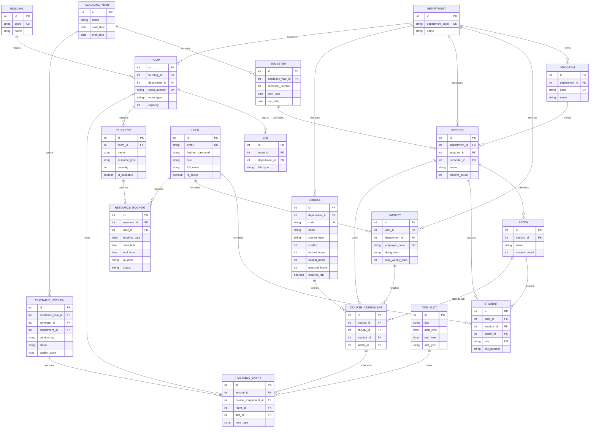

# Relational Database Architecture & Entity-Relationship Model

**Database:** SQLite (`data/campus.db`) / PostgreSQL  
**Engine:** SQLAlchemy 2.0 Declarative ORM  
**Referential Integrity:** Enforced via `PRAGMA foreign_keys = ON;`  

---

## 1. Complete Entity-Relationship Diagram

---

## 2. Relational Integrity Rules
1. **Academic Hierarchy Cascade:** Deleting an `AcademicYear` cascades to related `Semester` records. Sections strictly map to a single `Department`, `Program`, and `Semester`.
2. **Subdivision Invariant:** A `Batch` strictly belongs to a parent `Section`. The sum of student counts across batches in a section does not exceed the section's total student count.
3. **Lab Exclusivity:** Course assignments marked `PRACTICAL` must link to a `Batch` and can only be scheduled into rooms flagged with `room_type = 'LAB'` and indexed in `LAB`.
4. **Referential Constraints:** All foreign keys are indexed. SQLite enforces foreign keys on every connection via `PRAGMA foreign_keys = ON;`.

