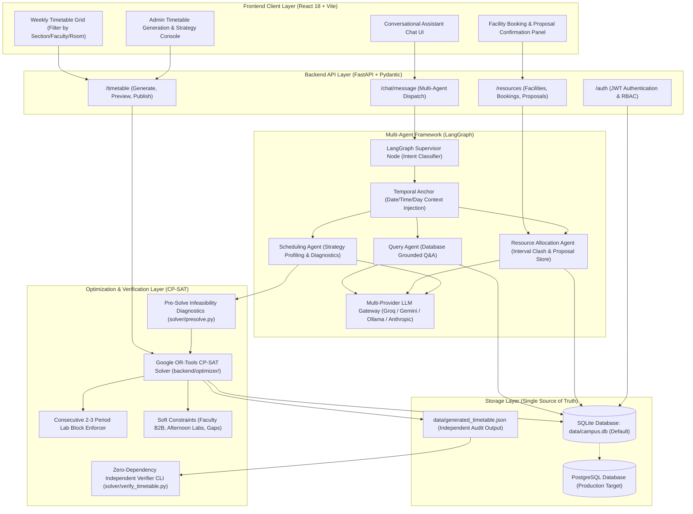
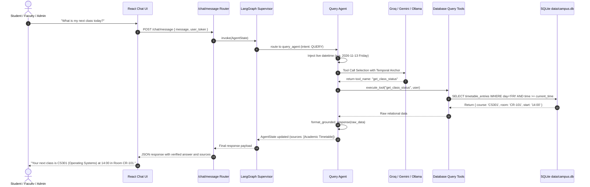
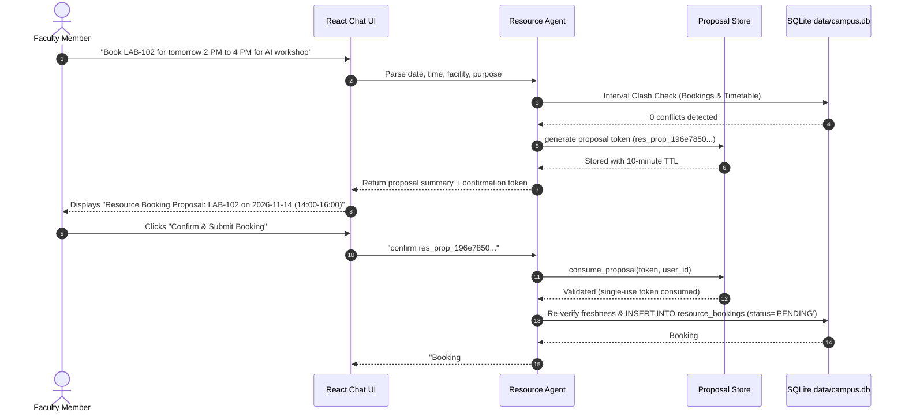

# System Architecture & Multi-Agent Orchestration

**Project:** Multi-Agent Campus Assistant & Automated Timetable Engine (RIO-MJP)  
**Architecture Pattern:** Layered Multi-Agent System with Shared State & Independent Verifier  

---

## 1. High-Level System Architecture

---

## 2. Multi-Agent Interaction & Execution Flows

### A. Grounded Query Execution Flow

### B. Facility Booking & Cryptographic Proposal Flow

---

## 3. Mathematical Optimization & Independent Verification Architecture

1. **Pre-Solve Infeasibility Diagnostics (`solver/presolve.py`):**
   - Evaluates whether $\sum \text{Required Hours} \le \text{Total Slots}$ across each section, batch, and faculty member.
   - Evaluates whether $\text{Class Size} \le \max(\text{Room Capacity})$.
   - Evaluates total lab hours vs available lab rooms $\times$ slots (Pigeonhole principle).

2. **Google OR-Tools CP-SAT Solver (`backend/optimizer/timetable_solver.py`):**
   - Decision variables: $x(a, h, r, t) \in \{0, 1\}$.
   - Contiguous lab blocks: Boolean block choice variables for 2-hour and 3-hour practical courses enforcing $(t, t+1)$ or $(t, t+1, t+2)$ on the same day in the same laboratory room.
   - Objective: Minimizes weighted penalty terms for faculty back-to-back periods ($> 2$ periods), morning lab slots, faculty schedule gaps, student gaps, and room changes.

3. **Standalone Independent Verifier CLI (`solver/verify_timetable.py`):**
   - Independent verification component written with **zero external dependencies** (Python standard library only).
   - Reads any exported schedule JSON and systematically asserts:
     - Hard Constraint 1: $\forall i \neq j, \text{faculty}_i == \text{faculty}_j \implies \neg \text{overlap}(t_i, t_j)$
     - Hard Constraint 2: $\forall i \neq j, \text{room}_i == \text{room}_j \implies \neg \text{overlap}(t_i, t_j)$
     - Hard Constraint 3: $\forall i \neq j, \text{cohort}_i == \text{cohort}_j \implies \neg \text{overlap}(t_i, t_j)$
     - Hard Constraint 4: $\forall i, \text{capacity}(\text{room}_i) \ge \text{size}(\text{cohort}_i)$
     - Hard Constraint 5: Practical sessions are strictly contiguous and housed in lab facilities.

